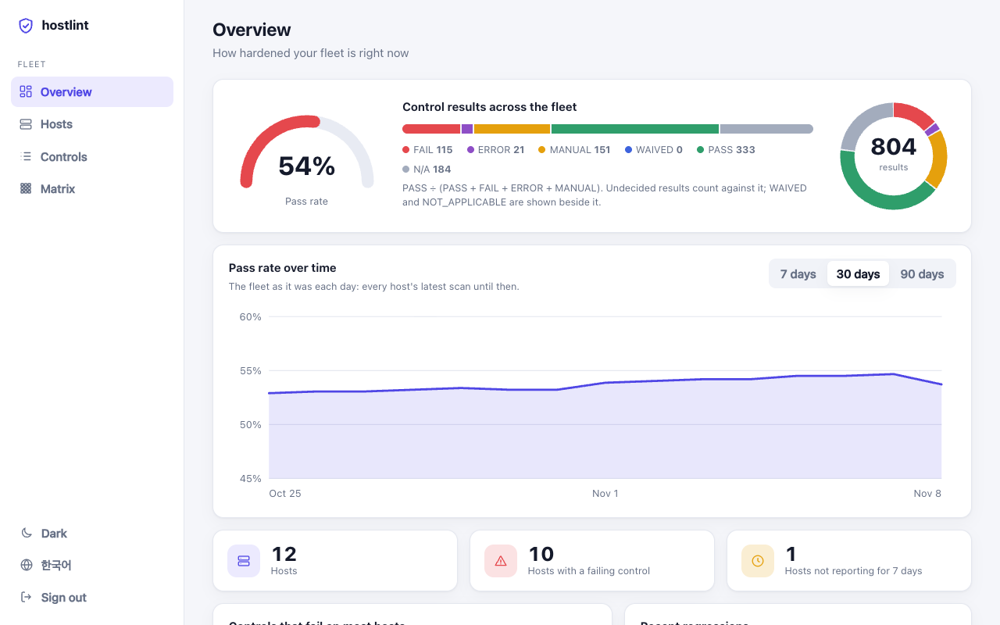
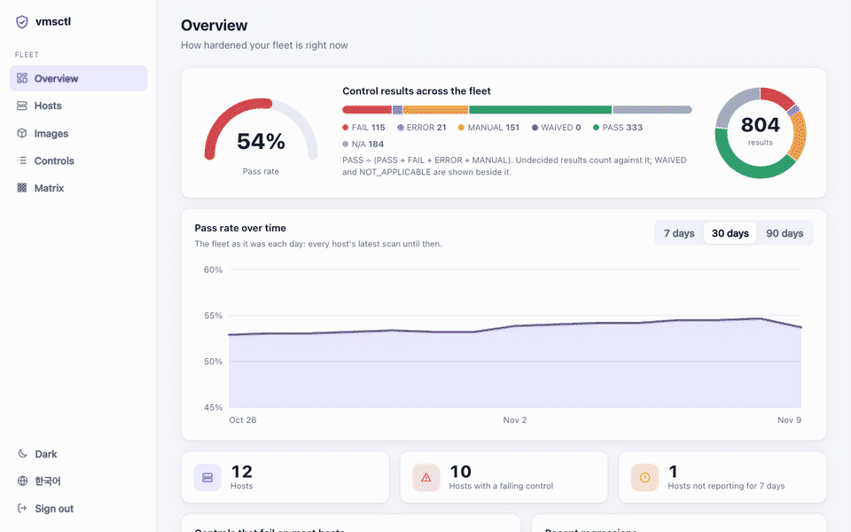
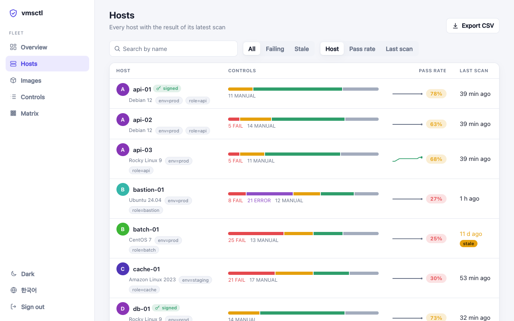
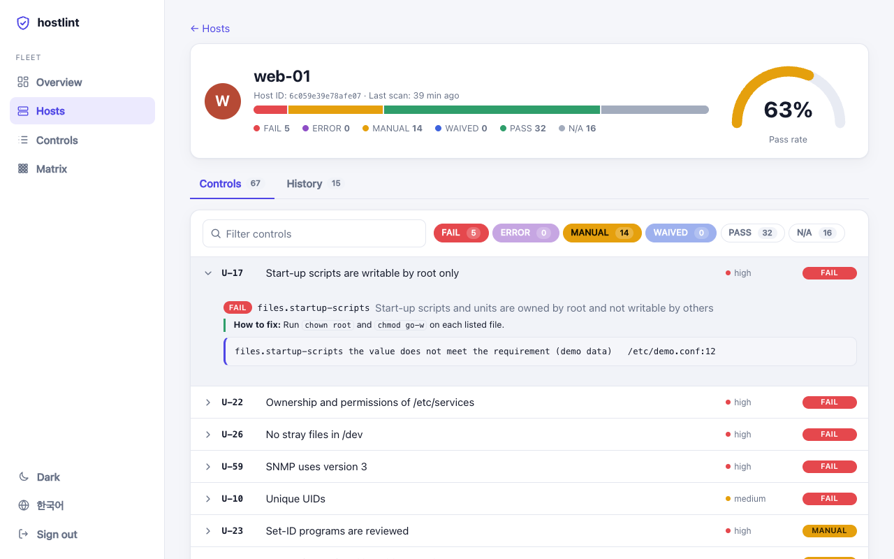
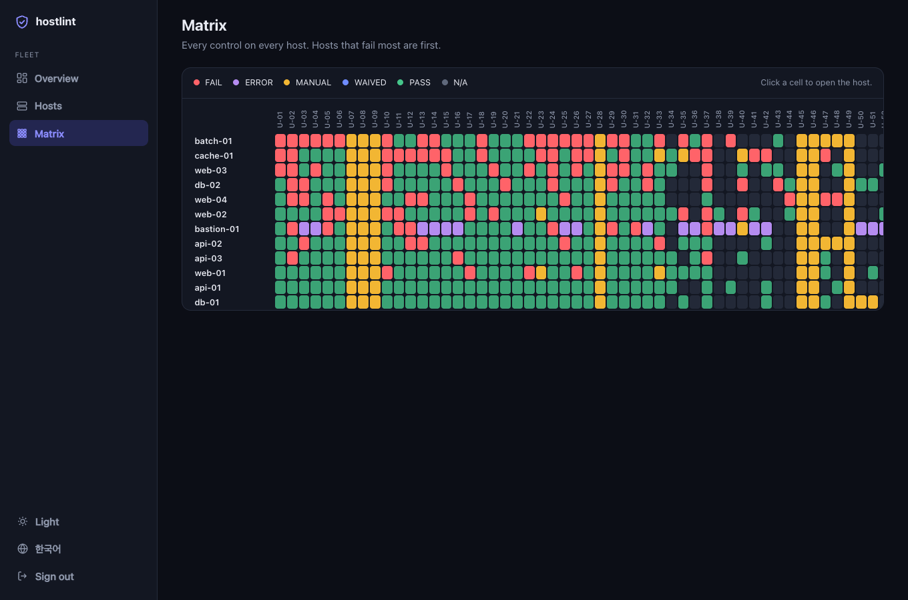
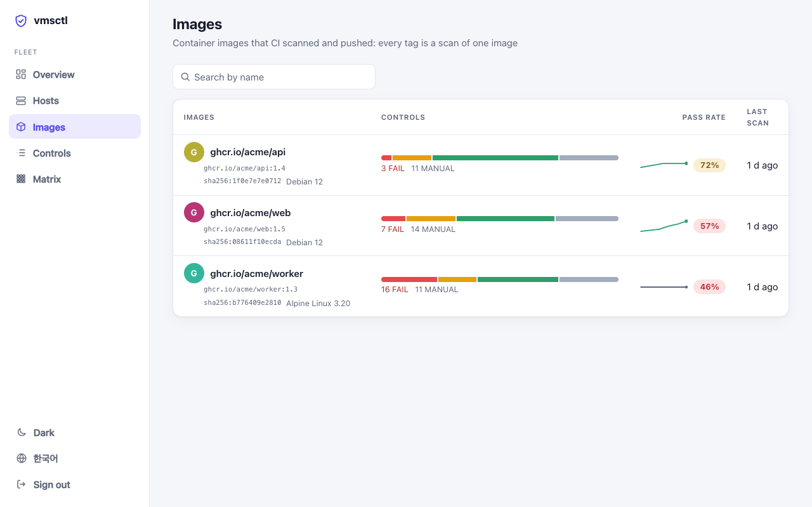

<!-- translated from README.md @ c9fde8b -->
# vmsctl

[](https://github.com/with-developer/vmsctl/actions/workflows/ci.yml)
[](LICENSE)

**리눅스 서버가 얼마나 안전하게 설정되어 있는지, 모든 판정의 근거와 함께 알려 줍니다.**

vmsctl은 서버의 보안 설정을 읽어서 점검 기준(주요정보통신기반시설 기술적 취약점 분석·평가 가이드 Unix 편, 그리고 대부분의
가이드가 공통으로 요구하는 간추린 기준)의 점검 항목마다 결과를 냅니다. 여러 서버의 결과는 대시보드 하나로 봅니다.
서버를 바꾸는 일은 없고, 판단하지 못한 것을 PASS로 추측하지도 않습니다.

[**라이브 데모**](https://with-developer.github.io/vmsctl/demo/) · [빠른 시작](#빠른-시작) · [대시보드](#여러-서버를-한눈에-보는-대시보드) · [문서](docs/README.ko.md) · [English](README.md)



- **판정만이 아니라 근거를 보여 줍니다.** 값, 그 값이 나온 파일과 줄, 직접 설정한 값인지 기본값인지까지 보여 주고,
  실패한 점검에는 조치 방법이 한국어로도 붙습니다.
- **PASS를 추측하지 않습니다.** 판단하지 못한 것은 `ERROR`나 `MANUAL`로 알립니다. 설정은 해당 프로그램이 읽는 방식
  그대로 읽습니다. PAM은 libpam처럼, `login.defs`는 shadow-utils처럼, 셸 파일은 bash처럼 해석합니다.
- **읽기만 하는 바이너리 하나.** 규칙은 스크립트가 아니라 데이터라서 서버를 바꿀 수 없고, 비밀 정보는 결과에 나오지 않습니다.
  서버, 마운트한 루트, 컨테이너 이미지 모두 `vmsctl scan` 하나로 점검합니다.
- **서버 한 대에서 전체 서버까지.** 호스트가 결과를 보내기만 하고 중앙 서버는 호스트에 접속하지 않습니다. 이력, 추이,
  악화한 항목, 서명된 결과, 모든 호스트의 모든 점검 항목을 한 장에 보여 주는 매트릭스를 제공합니다.
- **파이프라인에 바로 씁니다.** 스키마가 있는 JSON, SARIF, JUnit, Markdown, CSV와 [GitHub Action](docs/ci.ko.md)을 지원합니다.

**호스트 없이 대시보드부터 보려면:** 브라우저에서 바로 여는 [라이브 데모](https://with-developer.github.io/vmsctl/demo/)(가상의 데이터)나, 내 컴퓨터에서 `vmsctl server demo` ([먼저 설치](#빠른-시작))

## 점검 결과는 이렇게 보입니다


```text
$ sudo vmsctl scan
vmsctl v0.41.0 · kisa-2026 · web-01 (Debian GNU/Linux 12 (bookworm))

✗ FAIL   U-01   Restrict direct remote root login [high]
    ✗ ssh.permit-root-login — SSH does not allow direct root login
        "yes" (explicit); expected one of [no]  /etc/ssh/sshd_config:33
    ? services.review-remote-root-login — Review root login through telnet and other remote terminal services
        Check that root cannot log in through the service (pam_securetty in its auth stack and no pts/N line in /etc/securetty, where that module exists). Better, turn the service off.
        telnet (inetd) at /etc/inetd.conf:42
? MANUAL U-07   Remove unneeded accounts [low]
    ? accounts.review-login-accounts — Review accounts that can log in
        Confirm that every listed account is still needed, especially accounts of people who have left. Default accounts such as lp, uucp or games appear here only when they were given a login shell, which they should not have.
        root (uid 0, /bin/bash)
✗ FAIL   U-18   Ownership and permissions of /etc/shadow [high]
    ✗ files.shadow-perms — /etc/shadow is owned by root and readable by root only
        /etc/shadow: root:shadow 0640 — mode 0640 exceeds 0400
✗ FAIL   U-52   Telnet is off [medium]
    ✗ services.no-telnet — Telnet is not started
        telnet (inetd, /usr/sbin/telnetd) at /etc/inetd.conf:42
...

kisa-2026: 67 controls — 10 FAIL, 11 MANUAL, 29 PASS, 17 NOT_APPLICABLE
```

위 출력은 `PermitRootLogin yes`와 inetd telnet 서비스를 추가한 Debian 12 컨테이너의 결과를 줄인 것입니다
(호스트 이름은 줄였습니다).

## 여러 서버를 한눈에 보는 대시보드

호스트가 스스로 점검하고 결과를 `vmsctl server`로 보내면, 서버가 이력을 쌓아 두고 웹 대시보드로
보여 줍니다. 영어와 한국어, 라이트·다크 테마, 휴대폰 화면을 지원합니다.



```sh
vmsctl server demo      # 가상의 호스트 12대로 둘러보기. 실제로 점검하거나 저장하지 않습니다. 출력된 주소를 여세요
```

- **통과율이 시간에 따라 어떻게 달라졌는지** 7일·30일·90일 차트로 보고, 호스트마다 최근 추이도 봅니다.
- **가장 많은 호스트에서 실패하는 점검 항목과 방금 나빠진 점검 항목**을 바로 확인합니다.
- **모든 결과에 근거**(파일과 줄)가 붙고, 실패한 항목 옆에 **조치 방법**이 나옵니다.
- **모든 호스트 × 모든 점검 항목 매트릭스.** 칸을 누르면 그 호스트로 이동합니다.
- 프로파일(KISA, essentials, 직접 만든 정책 팩)을 **한 번에 하나씩** 골라 봅니다. 목록에는 호스트의 OS와 라벨이 보입니다.
- **CI에서 점검한 이미지:** `scan --image-tar app.tar --push`를 쓰면 이미지마다 페이지가 생기고, 빌드마다 태그가 이력으로 쌓입니다.
- **지금 스캔:** 호스트의 에이전트가 먼저 서버에 연결해 두었다가, 대시보드에서 요청하면 호스트가 허용한 프로파일로 점검합니다.
  서버가 호스트에 접속하는 일은 없습니다.
- **서명된 결과:** 저장된 결과가 바뀌지 않았는지 호스트의 서명 키로 확인할 수 있습니다.

실제 결과를 보내기 전에 데모로 먼저 둘러보세요. 자세한 내용은 [docs/fleet.ko.md](docs/fleet.ko.md)에 있습니다.

## 더 알아보기

- **기준을 겹쳐 쓸 수 있습니다.** 점검은 한 번만 작성하고 기준마다 점검 항목에 연결합니다. 주요정보통신기반시설 기술적
  취약점 분석·평가 가이드 2026년판(Unix U-01–U-67), 간추린 `essentials` 기준, 그리고 직접 만든 [정책 팩](docs/packs.ko.md)이
  있습니다.
- **실행 중인 서버도, 컨테이너 이미지도.** 실행 중인 시스템, 다른 곳에 마운트한 루트 파일시스템(`--root`),
  `docker save`로 만든 이미지 아카이브(`--image-tar`)를 점검합니다.
- **실패한 점검마다 조치 방법.** `explain`, JSON(`remediation`), SARIF(코드 스캐닝이 경고와 함께 보여 주는 규칙 도움말),
  Markdown 요약, HTML 보고서, 대시보드에서 볼 수 있습니다.

Lynis, OpenSCAP, Wazuh와 무엇이 다르고 어떤 경우에 그쪽이 더 나은지는 [docs/comparison.ko.md](docs/comparison.ko.md)에 정리했습니다.

## 빠른 시작

릴리스를 설치합니다(Linux, amd64 또는 arm64). `install.sh`는 아카이브의 SHA-256을 확인하고,
`cosign`이 설치되어 있으면 체크섬의 Sigstore 서명까지 확인합니다.

```sh
curl -fsSLO https://raw.githubusercontent.com/with-developer/vmsctl/v0.41.0/install.sh
sudo sh install.sh -v v0.41.0     # 먼저 읽어 보세요. root 없이 설치하려면 -b DIR로 설치 위치를 지정하세요
sudo vmsctl scan
```

컨테이너 이미지로 실행할 수도 있습니다. 호스트의 루트를 읽기 전용으로 마운트합니다([docs/container.ko.md](docs/container.ko.md)).

```sh
docker run --rm -v /:/host:ro ghcr.io/with-developer/vmsctl:0.41.0 scan --root /host
```

[릴리스](https://github.com/with-developer/vmsctl/releases)에는 `.deb`·`.rpm` 패키지, SBOM, 빌드 출처 증명도
함께 올라갑니다(`gh attestation verify FILE -R with-developer/vmsctl`). v0.26.0까지는 hostlint라는 이름으로 나왔으므로
그 버전은 `-R with-developer/hostlint`로 검증하세요. hostlint를 쓰고 계셨다면
[docs/migrating-from-hostlint.ko.md](docs/migrating-from-hostlint.ko.md)를 보세요. 직접 빌드하려면 Go 1.26 이상이 필요하고,
바이너리 자체에는 외부 의존성이 없습니다:

```sh
go install github.com/with-developer/vmsctl/cmd/vmsctl@v0.41.0
sudo "$(go env GOPATH)/bin/vmsctl" scan
```

root가 아니면 `/etc/shadow`처럼 보호된 파일이 필요한 점검은 `ERROR`가 됩니다.

```sh
# 프로그램이 읽을 수 있는 결과(JSON)
sudo vmsctl scan --format json --output web-01.json

# 마운트한 루트 파일시스템(이미지, VM 디스크). 실행 중이어야 알 수 있는 점검은 ERROR나 NOT_APPLICABLE
sudo vmsctl scan --root /mnt/image

# 컨테이너 이미지: docker save로 만든 아카이브를 그대로 점검합니다. 마운트도, 실행도, 쓰기도 하지 않습니다
docker save app:1.4 -o app.tar && vmsctl scan --image-tar app.tar --fail-on high

# CI: 심각도 high 이상 점검 항목이 실패할 때만 빌드를 실패시킵니다(GitHub Action, GitLab 등: docs/ci.ko.md)
sudo vmsctl scan --fail-on high --format junit --output vmsctl.xml

# 여러 호스트의 결과를 HTML 보고서 하나로: 네트워크 요청을 하지 않는 단일 파일
vmsctl report results/*.json --output report.html

# 실패한 점검 항목이 무슨 뜻이고 어떻게 고치는지
vmsctl explain --list                         # 모든 점검 항목과 점검을 제목과 함께 나열
vmsctl explain U-02 ssh.permit-root-login

# 지난 점검 이후 무엇이 바뀌었는지: 새로 실패한 것, 해결된 것, 그 원인이 된 점검
vmsctl diff before.json after.json
vmsctl diff baseline.json current.json --fail-on-regression   # 점검 항목이 나빠졌으면 종료 코드 1

# 여러 호스트의 결과를 모아 대시보드로 보여 주는 서버 (docs/fleet.ko.md 참고)
vmsctl server run --db server.db --listen :8443
sudo VMSCTL_TOKEN=hlt_ing_... vmsctl scan --push https://vmsctl.example.org:8443

# 프로파일을 고르고, 기준을 더 엄격하게 바꾸고, 감수하기로 한 항목은 예외(waiver)로 처리
sudo vmsctl scan --config vmsctl.yaml
```

각 결과를 결정한 점검은 출력에 나열됩니다. `--config`와 파일 형식은
[docs/configuration.ko.md](docs/configuration.ko.md)에 설명되어 있습니다.

| 플래그 | 의미 |
|---|---|
| `-p, --profile` | 점검할 프로파일(기본값 `kisa-2026`). 여러 번 쓰면 한 번에 여러 개를 점검합니다 |
| `-f, --format` | `table`, `json`, `sarif`, `junit`, `markdown`(작업 요약이나 댓글용), `csv`(점검 항목마다 한 줄, 스프레드시트용: 엑셀에서 한글 제목이 깨지지 않고 열립니다. 수식으로 읽힐 값은 작은따옴표로 시작하는데, 엑셀이 CSV 파일을 열 때는 그 따옴표가 그대로 보입니다) |
| `--lang` | `en`(기본값) 또는 `ko`: 표와 Markdown에서 점검 항목과 점검의 제목, 사람이 검토해야 하는 점검의 안내, Markdown 보고서의 조치 방법을 한국어로 보여 줍니다. 규칙에 한국어 글이 있는 것만 해당하고, 근거 같은 나머지는 영어 그대로입니다. `vmsctl explain --lang ko`는 점검 항목이나 점검을 같은 방식으로 한국어로 설명하고, `vmsctl diff --lang ko`는 표의 제목을 한국어로 보여 줍니다. `VMSCTL_LANG`으로도 정할 수 있고 `ko_KR.UTF-8` 같은 로케일 값도 읽으며, 지원하지 않는 값은 무시합니다. JSON, SARIF, JUnit은 번역하지 않습니다. JSON 결과에는 한국어 조치 방법이 `remediationKo`로, 사람이 검토해야 하는 점검의 한국어 안내가 `reasonKo`로 들어가고, CSV에는 `title_ko`와 마지막 열 `how_to_fix_ko`가 있습니다 |
| `-o, --output` | 결과를 파일로 저장합니다 |
| `--fail-on` | 이 심각도 이상의 점검 항목이 실패하거나 판단하지 못하면(`ERROR`) 종료 코드 1을 돌려줍니다: `low`(기본값), `medium`, `high`, `none` |
| `--pack DIR` | 정책 팩(직접 만든 점검과 프로파일)을 불러옵니다([docs/packs.ko.md](docs/packs.ko.md)). 팩의 프로파일은 `-p`로 고릅니다 |
| `--root` | 이 디렉터리에 마운트된 파일시스템을 점검합니다(운영체제가 들어 있어야 합니다) |
| `--image-tar` | 이 아카이브에 든 컨테이너 이미지의 파일시스템을 점검합니다([docs/images.ko.md](docs/images.ko.md)). `--push`와 함께 쓰면 이미지가 서버에서 독립된 항목이 되고, `--name`으로 이름을 정합니다 |
| `--config` | 설정 파일 (기본값: `./vmsctl.yaml`, 없으면 `/etc/vmsctl/vmsctl.yaml`) |
| `--label key=value` | 결과의 호스트 정보에 라벨을 붙입니다 |
| `--color` | `auto`(기본값), `always`, `never` |
| `-v, --verbose` | 통과·해당 없음 점검 항목도 표에 보여 줍니다 |

> 🚧 **아직 초기 단계입니다.** 흔치 않은 환경에서는 어색한 부분이 있을 수 있으니 알려 주세요.
> [로드맵](docs/ROADMAP.md)과 [릴리스 이력](docs/RELEASING.md)을 참고하세요.

## 결과

| 상태 | 의미 |
|---|---|
| `PASS` | 점검 항목을 충족합니다. 근거가 그 이유를 보여 줍니다 |
| `FAIL` | 충족하지 못합니다. 무엇이 문제인지 근거에 나옵니다 |
| `MANUAL` | 사람이 판단해야 합니다. 검토할 사실을 함께 보여 줍니다 |
| `NOT_APPLICABLE` | 해당하지 않습니다(예: 해당 서비스가 설치되어 있지 않음) |
| `ERROR` | 믿을 수 있게 판단하지 못했습니다. 이유를 보여 줍니다 |
| `WAIVED` | 설정 파일의 예외로 `FAIL`이나 `MANUAL`을 받아들였습니다. 원래 상태와 근거는 그대로 남습니다([docs/configuration.ko.md](docs/configuration.ko.md)) |

점검 항목의 상태는 소속 점검 중 가장 나쁜 결과를 따릅니다: `FAIL` > `ERROR` > `MANUAL` > `WAIVED` >
`PASS` > `NOT_APPLICABLE`.

종료 코드는 `--fail-on` 기준 이상으로 실패한 점검 항목이 없으면 0, 있으면 1, 사용법 오류이거나 점검을 실행하지 못했으면 2,
중간에 중단되면 130입니다.

## 무엇을 점검하나

`kisa-2026` 프로파일은 KISA 가이드(2026년판)의 Unix 점검 항목 67개를 모두 담았고, `stig-ubuntu2204`는 미국 DISA의 Ubuntu 22.04 STIG 중 vmsctl이 판정할 수 있는 27개를 담았습니다([점검 범위](docs/stig.ko.md)). 점검 항목별 점검 내용, 매개변수,
조치 방법은 [규칙 참조](docs/rules.ko.md)에 한국어로 있고, KISA 점검 항목만 모은 [웹 페이지](https://with-developer.github.io/vmsctl/ko/kisa/)도 있습니다.

- **계정 관리 (U-01–U-13):** root 원격 접속, 비밀번호 길이·복잡도·사용 기간, 계정 잠금, 비밀번호
  파일 보호, UID 0, `su` 제한, 세션 타임아웃, 비밀번호 해시 알고리즘.
- **파일 및 디렉터리 관리 (U-14–U-33):** `PATH`, 시스템 파일의 소유자와 권한, 시작 스크립트,
  set-ID 프로그램, 누구나 쓸 수 있는 파일, `/dev`의 일반 파일, `.rhosts`, `umask`, 홈 디렉터리.
  로컬 파일시스템을 정해진 한도 안에서 훑는 점검도 있습니다.
- **서비스·패치·로그 관리 (U-34–U-67):** finger, r 계열, telnet, tftp, NFS, NIS, SNMP 같은 오래된 서비스(활성화된
  유닛, 실행 중인 유닛, init 스크립트, inetd·xinetd까지), SNMP community 문자열과 접근 범위(`snmpd.conf`는 읽지만
  값은 결과에 담지 않습니다), Postfix 오픈 릴레이와 VRFY, BIND의 존 전송·업데이트, NFS 공유, vsftpd의 배너·TLS·root
  로그인·익명 접근, Samba 게스트 공유, cron과 sudoers 권한, 시각 동기화.

사람이 판단해야 하는 점검 항목(남길 계정, 배너, 로그 정책, 패치 수준, 서비스 접근 범위)과 아직 설정을 읽지 못하는
서버(Postfix 외의 메일 서버, BIND 외의 DNS 서버, vsftpd 외의 FTP 서버)의 설정은 `MANUAL`로 나오며, 검토할 사실이
함께 나열됩니다. 해당 소프트웨어가 실행 중이 아니면 `NOT_APPLICABLE`입니다. 지원 대상은 Ubuntu 22.04/24.04/26.04,
Debian 12/13, RHEL 호환 9/10(Rocky Linux, AlmaLinux), Amazon Linux 2023, CentOS/RHEL 7(가능한 범위에서 지원)입니다. 그 밖의
버전도 점검은 하되, 결과에 최선 노력(best-effort) 지원이라고 표시합니다.

`essentials` 프로파일(`--profile essentials`)은 특정 국가 표준과 상관없이, 대부분의 리눅스 보안 강화 가이드가 공통으로
권하는 항목만 추린 짧은 기준입니다. SSH(root 로그인 금지, 비밀번호 로그인 금지, 빈 비밀번호 금지, 시도 횟수 제한,
X11 전달 금지, 취약한 암호 알고리즘 사용 금지, 로그 기록, 이를 뒤집는 `Match` 블록 금지), UID 0과 비밀번호 파일, 비밀번호 길이·해시·사용 기간·잠금, `su`와
sudo, cron, 오래된 원격 서비스, 위험한 파일 권한, 시각 동기화, 중요한 커널 매개변수(주소 무작위화, `kptr_restrict`,
ICMP 리다이렉트, 역방향 경로 필터링, SYN 쿠키 등), 호스트 방화벽, 자동 보안 업데이트, 강제 접근 제어(SELinux나 AppArmor), 빈 비밀번호, 인쇄·네트워크 검색 서비스(CUPS, Avahi)를
다룹니다. 점검 항목 29개(`ES-01`–`ES-29`)에는 자체 ID가 있고, 대부분 다른 프로파일과 같은 점검을 쓰며, SSH 점검 10개와 커널 매개변수
점검 11개, 방화벽·업데이트·접근 제어·빈 비밀번호·인쇄/검색 서비스 점검이 새로 더해졌습니다. 커널·방화벽·업데이트·접근 제어 점검은 자체 커널도 방화벽도 없는
컨테이너 이미지에는 적용되지 않습니다.

우리 조직만의 기준은 [정책 팩](docs/packs.ko.md)으로 만드세요. 같은 YAML 형식의 점검과 프로파일을 디렉터리에 담은 것이며,
`vmsctl pack test`로 테스트하고 `vmsctl pack show`로 내용을 검토한 뒤 `vmsctl scan --pack`으로 씁니다. 팩은 새로운
권한을 더하지 않습니다(아무것도 실행할 수 없고, 내장 점검이 읽지 못하는 파일은 팩도 읽지 못합니다). 결과에는 팩의 이름과
다이제스트가 남습니다.

점검 제목과 설명은 vmsctl이 직접 썼고, 프로파일은 기준 문서의 점검 항목 번호만 참조합니다.

## 대시보드 화면

| 개요 | 호스트 목록: 추이, OS, 라벨 |
|---|---|
|  |  |

| 호스트 하나: 점검 항목, 근거, 실패마다 조치 방법 | 모든 호스트의 모든 점검 항목 매트릭스(다크) |
|---|---|
|  |  |

| CI가 보낸 이미지: 이미지마다 이력 하나, 빌드마다 태그 하나 |
|---|
|  |

동작 방식, API, 서명, 알림, 에이전트는 [docs/fleet.ko.md](docs/fleet.ko.md)에 있습니다.

## 원칙

vmsctl은 타협하지 않는 몇 가지 원칙 위에 만들어졌습니다. 자세한 내용은 [비전](docs/VISION.md)과
[설계 결정 기록](docs/adr/)을 참고하세요.

1. **보기만 합니다.** 점검 대상 서버를 바꾸는 코드 경로는 어디에도 없습니다([ADR 0004](docs/adr/0004-observation-only.md)).
2. **비밀은 서버 밖으로 나가지 않습니다.** 비밀번호 해시, 키, 토큰은 결과·로그·오류 메시지 어디에도 담기지 않습니다.
3. **PASS를 추측하지 않습니다.** 확실히 판단할 수 없으면 `ERROR`나 `MANUAL`입니다([ADR 0006](docs/adr/0006-rule-format-evaluation-results.md)).
4. **점검 내용은 직접 씁니다.** CIS 벤치마크나 KISA 가이드의 문구는 가져다 쓰지 않고, 점검 항목 번호만 참조합니다.
5. **설치도 실행도 평범해야 합니다.** 특별한 준비 없이 실행 파일 하나로 끝나야 합니다.

## 상태

vmsctl은 활발히 개발 중입니다. KISA 2026 프로파일(U-01–U-67), 수집기, 터미널·JSON·SARIF·JUnit·여러 호스트용 HTML 출력,
예외(waiver)를 담는 설정 파일, 릴리스 파이프라인(서명된 아카이브, 패키지, SBOM, `install.sh`), 지원하는 모든 배포판에
대한 컨테이너 테스트, 컨테이너 이미지 점검([docs/images.ko.md](docs/images.ko.md)), GitHub Action
([docs/ci.ko.md](docs/ci.ko.md)), 대시보드가 있는 서버와 서명된 결과, 웹훅([docs/fleet.ko.md](docs/fleet.ko.md)),
요청이 오면 점검하는 에이전트, 컨테이너 이미지 배포([docs/container.ko.md](docs/container.ko.md))까지 갖췄고, 최신
릴리스는 v0.41.0입니다. 앞으로의 계획은 [로드맵](docs/ROADMAP.md)을 참고하세요.

## 라이선스

[Apache-2.0](LICENSE)
